<div align="center">

# 🌐 RedeMaster | Portal Acadêmico de Redes de Computadores

**Plataforma de Alta Performance para Revisão Teórica, Engenharia de Sub-redes e Simulado com Gabarito Comentado**

[](https://wallace-2105.github.io/Redes-de-computador-/)
[](#)
[](#)
[](#)
[](#)

---

### 🚀 **[Clique Aqui para Acessar o Portal Online](https://wallace-2105.github.io/Redes-de-computador-/)**

*Ambiente de estudos interativo, responsivo e projetado com padrões acadêmicos de nível superior.*

---

</div>

## 📌 1. Apresentação e Propósito Acadêmico

O **RedeMaster** foi concebido e estruturado para suprir uma das maiores demandas de estudantes e futuros profissionais de Ciência da Computação, Engenharia de Software, Redes de Computadores e Sistemas de Informação: **uma plataforma centralizada, visualmente moderna e pedagogicamente rigorosa para o estudo dos fundamentos de redes de computadores**.

Muitos materiais acadêmicos pecam pela fragmentação entre teoria pesada e prática de fixação. O RedeMaster une ambos os mundos em uma **Single Page Application (SPA) de alta fidelidade**, dividida em:
1. **Resumo Teórico Aprofundado ("O que preciso saber"):** Organizado em blocos sanfonados (*accordions*) com tabelas sinóticas, mnemônicos e busca instantânea.
2. **Calculadora Dinâmica de Sub-redes IPv4:** Ferramenta interativa de cálculo de prefixos CIDR, decomposição binária, determinação de NetID, Broadcast e hosts válidos.
3. **Simulado de Alta Exigência (30 Questões):** Banco rigoroso dividido em 10 fáceis, 10 médias e 10 difíceis (incluindo cálculo de IP, comutação de switches, temporização CSMA/CD e controle de fluxo).
4. **Relatório Analítico de Feedback com Explicação Técnica:** Gabarito completo com justificativa técnica individual para cada alternativa, explicando a fundamentação física e lógica da questão.

---

## 🎯 2. Visão Geral da Arquitetura Pedagógica

```mermaid
graph TD
    A[Portal RedeMaster] --> B[1. Resumo Teórico Interativo]
    A --> C[2. Calculadora IPv4 / CIDR]
    A --> D[3. Simulado Rigoroso - 30Q]
    A --> E[4. Relatório & Gabarito Comentado]

    B --> B1[Comunicação de Dados & Meios]
    B --> B2[Modelos OSI 7 Camadas vs TCP/IP 4 Camadas]
    B --> B3[Topologias & Classificação PAN/LAN/MAN/WAN]
    B --> B4[Equipamentos L1, L2, L3 & Domínios]
    B --> B5[Ethernet, CSMA/CD, Comutação & 802.3x]
    B --> B6[Cálculo de IPv4, Classes, RFC 1918 & VLSM]

    D --> D1[10 Questões Fáceis: Conceitos Fundamentais]
    D --> D2[10 Questões Médias: Equipamentos, Padrões & Enlaces]
    D --> D3[10 Questões Difíceis: Sub-redes, Backoff & Comutação Avançada]

    E --> E1[Scorecard Visual em Anel Circular]
    E --> E2[Métricas por Nível de Dificuldade]
    E --> E3[Filtros de Erros / Acertos / Dificuldade]
    E --> E4[Justificativa Técnica Individualizada]
```



---

## 📚 3. Conteúdo Programático Abordado

### 3.1. Comunicação de Dados e Modos de Transmissão
- **Quatro Elementos Básicos:**
  - **Transmissor (Sender):** Codificação e adequação de sinais digitais ao canal físico.
  - **Receptor (Receiver):** Recepção, demodulação e decodificação na forma inteligível.
  - **Meio de Transmissão (Canal):** Meios guiados (par trançado, coaxial, fibra) e não-guiados (radiofrequência). Fenômenos de atenuação, ruído térmico e distorção.
  - **Protocolo:** Conjunto de convenções que estabelece sintaxe, semântica e temporização.
- **Direcionalidade de Transmissão:**
  - *Simplex:* Comunicação estritamente unidirecional (ex: teclado para CPU, radiodifusão FM).
  - *Half-Duplex:* Bidirecional alternada no tempo (ex: walkie-talkie, Ethernet com Hub).
  - *Full-Duplex:* Bidirecional simultânea com vias dedicadas de Tx e Rx (ex: Ethernet com Switch).

---

### 3.2. Modelos de Referência: OSI (7 Camadas) vs. TCP/IP (4 Camadas)

A plataforma apresenta um comparativo didático com o mapeamento direto entre os dois modelos e suas respectivas **PDUs (Protocol Data Units)**:

| Camada OSI | PDU OSI | Função Primária | Camada TCP/IP | Exemplos de Protocolos |
| :--- | :--- | :--- | :--- | :--- |
| **7. Aplicação** | Dados | Interface direta com programas do usuário final | **Aplicação** *(condensa 7, 6 e 5)* | HTTP, HTTPS, DNS, DHCP, SSH, FTP, SMTP |
| **6. Apresentação** | Dados | Sintaxe, codificação, compressão e criptografia (SSL/TLS) | | ASCII, UTF-8, JPEG, TLS |
| **5. Sessão** | Dados | Abertura, controle de checkpoints e encerramento de diálogos | | RPC, NetBIOS, Sockets |
| **4. Transporte** | Segmento (TCP) / Datagrama (UDP) | Comunicação processo a processo, confiabilidade, controle de fluxo e portas lógicas | **Transporte** | TCP, UDP |
| **3. Rede** | Pacote (*Packet*) | Endereçamento lógico (IP) e roteamento de pacotes entre redes heterogêneas | **Internet** | IPv4, IPv6, ICMP, ARP, OSPF, BGP |
| **2. Enlace** | Quadro (*Frame*) | Endereçamento físico (MAC 48 bits), controle de acesso ao meio (MAC/LLC) e detecção de erros | **Acesso à Rede** *(condensa 2 e 1)* | Ethernet (802.3), Wi-Fi (802.11), PPP |
| **1. Física** | Bits | Especificações elétricas, mecânicas, óticas e transmissão bruta de pulsos | | Cabos Cat5e/Cat6, Conectores RJ45, Fibra Monomodo/Multimodo, Hubs |

> **Mnemônico para memorização das 7 camadas (de baixo para cima):**  
> **F**ísica, **E**nlace, **R**ede, **T**ransporte, **S**essão, **A**presentação, **A**plicação  
> 💡 *"**F**oi **E**m **R**oma **T**rabalhar **S**ó **A**té **A**manhã"*

---

### 3.3. Classificação Geográfica e Topologias de Rede

- **Classificação por Extensão Geográfica:**
  - **PAN (Personal Area Network):** Redes pessoais com alcance de até 10 metros (Bluetooth, fones sem fio, wearables).
  - **LAN (Local Area Network):** Redes locais em residências, laboratórios ou edifícios com altas velocidades e baixa latência.
  - **MAN (Metropolitan Area Network):** Extensão metropolitana interligando campi ou agências bancárias em uma cidade.
  - **WAN (Wide Area Network):** Abrangência continental e global (a própria Internet).

- **Topologias Físicas e Lógicas:**
  - **Estrela (Star):** Conexão centralizada em Switch. Falha em um cabo isola apenas o dispositivo afetado.
  - **Barramento (Bus):** Cabo tronco linear compartilhado. Exige **terminadores resistivos de 50 $\Omega$** nas extremidades para absorção de ondas e eliminação de reflexões que causariam colisões.
  - **Anel (Ring):** Topologia fechada onde circula o bastão de permissão (*Token Ring*).
  - **Árvore (Tree):** Estrutura hierárquica baseada em ramos (camadas de Núcleo, Distribuição e Acesso).
  - **Malha Completa (Full Mesh):** Cada nó conecta-se a todos os demais.  
    $$\text{Enlaces Necessários} = \frac{N \times (N - 1)}{2}$$  
    *Exemplo: Para 8 roteadores interconectados: $\frac{8 \times 7}{2} = 28$ enlaces dedicados.*

---

### 3.4. Equipamentos de Interconexão e Segregação de Domínios

| Equipamento | Camada OSI | Endereçamento | Domínio de Colisão | Domínio de Broadcast | Comportamento Principal |
| :--- | :---: | :---: | :---: | :---: | :--- |
| **Repetidor / Hub** | Camada 1 | Nenhum (sem lógica) | **1 único** *(compartilhado)* | **1 único** | Regenera o sinal elétrico e replica para todas as portas (*flooding* elétrico cego). |
| **Bridge / Switch L2** | Camada 2 | Endereço MAC (48 bits) | **1 por porta** *(isola)* | **1 único** *(por VLAN)* | Comuta quadros via tabela CAM/MAC. Cada porta possui banda dedicada (microsegmentação). Propaga broadcasts. |
| **Roteador L3** | Camada 3 | Endereço IP (Lógico) | **1 por porta** *(isola)* | **1 por interface** *(isola)* | Encaminha pacotes entre redes distintas com base na tabela de roteamento. **Bloqueia broadcasts por padrão**. |
| **Gateway** | Camadas 4 a 7 | Portas / Aplicação | Isolado | Isolado | Realiza tradução de protocolos e dados entre arquiteturas de rede totalmente incompatíveis. |

---

### 3.5. Arquitetura Ethernet e Mecanismos Avançados

- **Evolução de Velocidades:**
  - *Standard Ethernet:* 10BASE-T (10 Mbps - IEEE 802.3i).
  - *Fast Ethernet:* 100BASE-TX (100 Mbps - IEEE 802.3u).
  - *Gigabit Ethernet:* 1000BASE-T (1.000 Mbps - IEEE 802.3ab).
  - *10 Gigabit Ethernet:* 10GBASE-T (10.000 Mbps - IEEE 802.3an).

- **O Algoritmo CSMA/CD (*Carrier Sense Multiple Access with Collision Detection*):**
  1. **Carrier Sense:** Escuta o canal físico para checar se está livre.
  2. **Transmissão:** Começa a transmitir enquanto continua monitorando a tensão elétrica.
  3. **Detecção de Colisão:** Duas transmissões simultâneas dobram o sinal no cabo de meio compartilhado.
  4. **Jamming Signal:** Emissão imediata de um sinal de reforço de colisão (32 a 48 bits) para avisar todos os nós.
  5. **Truncated Binary Exponential Backoff:** Sorteio de tempo de espera no intervalo $[0, 2^k - 1] \times \text{slot time}$, onde $k = \min(\text{nº colisões}, 10)$. Dispersa os nós no tempo e evita colisões em cascata.
  > **Nota de Prova:** Em redes modernas com switches operando em **Full-Duplex**, as vias de transmissão (Tx) e recepção (Rx) são fisicamente separadas, eliminando a colisão física e **tornando o CSMA/CD desnecessário e desativado**.

- **Modos de Comutação em Switches:**
  - **Store-and-Forward:** Recebe o quadro completo, calcula e verifica o CRC/FCS de integridade. Maior segurança contra quadros corrompidos, porém com maior latência.
  - **Cut-Through:** Lê apenas os primeiros 6 bytes (endereço MAC de destino) e inicia o encaminhamento imediatamente. Menor latência, mas propaga quadros corrompidos (*runts*).
  - **Fragment-Free (Modified Cut-Through):** Inspeciona os primeiros **64 bytes** (tamanho mínimo de um quadro Ethernet legal). Filtra colisões e fragmentos espúrios com latência inferior ao Store-and-Forward.

- **Controle de Fluxo IEEE 802.3x (Pause Frames):**
  - Em enlaces Full-Duplex, quando os buffers de entrada de um switch ou servidor atingem limiar de transbordamento, ele envia um **Pause Frame** (EtherType `0x8808` com opcode `0x0001`) ao remetente solicitando a suspensão temporária do envio por um determinado tempo em *quanta*, evitando descarte de pacotes (*buffer overflow*).

---

### 3.6. Cálculo de IPv4 e Engenharia de Sub-redes

- **Conversão Decimal-Binário por Octeto (Potências de 2):**
  
  $$\begin{array}{|c|c|c|c|c|c|c|c|}
  \hline
  128 & 64 & 32 & 16 & 8 & 4 & 2 & 1 \\
  \hline
  \end{array}$$

  *Exemplo:* O octeto binário `11010000` = $128 + 64 + 16 = \mathbf{208}$.

- **Classes Tradicionais e Faixas Privadas (RFC 1918):**
  - **Classe A:** 1 a 126 (Máscara padrão: `/8` = `255.0.0.0`). Privado: `10.0.0.0/8` (`10.0.0.0` a `10.255.255.255`).
  - **Classe B:** 128 a 191 (Máscara padrão: `/16` = `255.255.0.0`). Privado: `172.16.0.0/12` (`172.16.0.0` a `172.31.255.255`).
  - **Classe C:** 192 a 223 (Máscara padrão: `/24` = `255.255.255.0`). Privado: `192.168.0.0/16` (`192.168.0.0` a `192.168.255.255`).
  - **Classe D:** 224 a 239 (Multicast).
  - **Especiais:** `127.0.0.1` (Loopback) e `169.254.0.0/16` (APIPA).

- **Tabela de Referência Rápida CIDR (/24 a /30):**

| Notação CIDR | Máscara Decimal | Salto (*Block Size*) | Total de IPs ($2^h$) | Hosts Válidos ($2^h - 2$) |
| :---: | :---: | :---: | :---: | :---: |
| **/24** | 255.255.255.0 | 256 | 256 | 254 |
| **/25** | 255.255.255.128 | 128 | 128 | 126 |
| **/26** | 255.255.255.192 | 64 | 64 | 62 |
| **/27** | 255.255.255.224 | 32 | 32 | 30 |
| **/28** | 255.255.255.240 | 16 | 16 | 14 |
| **/29** | 255.255.255.248 | 8 | 8 | 6 |
| **/30** | 255.255.255.252 | 4 | 4 | 2 *(enlaces seriais)* |

---

## 🧮 4. Calculadora Interativa de Sub-redes IPv4

Embutida diretamente no portal, permite a qualquer estudante simular e conferir instantaneamente os cálculos da matéria:
- Conversão binária de 32 bits em tempo real.
- Determinação exata de:
  - **Endereço de Rede (NetID)**
  - **Endereço de Broadcast**
  - **Primeiro Host Válido**
  - **Último Host Válido**
  - **Quantidade de Hosts Utilizáveis**
  - **Máscara em Formato Decimal Pontilhado**

---

## 📝 5. O Simulado: 30 Questões Rigorosas

O simulado foi projetado para reproduzir a pressão e o nível de profundidade exigidos em bancas examinadoras e provas de graduação:

- **10 Questões Fáceis (Q1 a Q10):**
  - Componentes da comunicação (protocolo, canal, transmissor).
  - Classificação geográfica de redes (LAN, PAN com Bluetooth).
  - Camadas básicas do modelo OSI (Física, Transporte, PDU de Segmento).
  - Conceito de topologia em estrela.
  - Camadas da arquitetura TCP/IP clássica (4 camadas).
  - Equipamentos de Camada 1 (Hub).
  - Máscara padrão de Classe C.

- **10 Questões Médias (Q11 a Q20):**
  - Segregação de domínios de colisão e broadcast em switches (24 portas = 24 colisões, 1 broadcast).
  - Operação Full-Duplex sem CSMA/CD em switches modernos.
  - Equivalência entre camadas superiores OSI e TCP/IP.
  - Especificação e taxas nominais do padrão Fast Ethernet (IEEE 802.3u - 100 Mbps).
  - Diferença de encaminhamento entre Switch L2 (MAC) e Roteador L3 (IP).
  - Função dos terminadores resistivos de 50 $\Omega$ no barramento coaxial.
  - Conversão binária de octetos (`11010000 = 208`).
  - Faixas privadas da norma RFC 1918 (`172.16.0.0/12`).
  - Diferencial técnico de Gateways de Aplicação.
  - Anatomia de endereços MAC de 48 bits (24 bits OUI + 24 bits NIC).

- **10 Questões Difíceis (Q21 a Q30):**
  - Decomposição completa da sub-rede `192.168.10.75/27` (Rede: .64, Broadcast: .95, 30 hosts).
  - Alocação de enlace ponto a ponto `10.0.0.12/30` (IPs úteis: .13 e .14).
  - Super-rede e agregação `172.20.16.0/22` (1022 hosts utilizáveis, Broadcast: .19.255).
  - Análise comparativa profunda entre *Cut-Through* e *Store-and-Forward*.
  - Protocolo de Controle de Fluxo IEEE 802.3x com *Pause Frames*.
  - Operação do algoritmo *Truncated Binary Exponential Backoff* no CSMA/CD.
  - Dimensionamento VLSM para conexão de 6 hosts sem desperdício (`/29`).
  - Justificativa física e temporal do limiar de 64 bytes no método *Fragment-Free*.
  - Determinação do último host e broadcast da sub-rede `172.16.50.144/28` (.158 e .159).
  - Cálculo combinatório de enlaces para Malha Completa com 8 roteadores ($L = 28$).

---

## 🏆 6. Tela de Resultados e Feedback Analítico

Ao concluir a 30ª questão, a aplicação oculta o simulador e gera um relatório completo:
- **Anel de Scorecard Dinâmico:** Gráfico vetorial SVG circular com cálculo de aproveitamento percentual.
- **Detalhamento por Nível:** Métricas discriminadas de acertos em fáceis, médias e difíceis.
- **Gabarito Técnico Comentado:** Todas as 30 questões são listadas com a resposta do usuário (marcada com ✅ ou ❌), o gabarito oficial e um **parágrafo analítico detalhado** justificando a resposta com base na fundamentação teórica.
- **Filtros Interativos:** Possibilidade de inspecionar apenas os erros para revisão rápida.

---

## 💻 7. Tecnologias Utilizadas

Este projeto foi construído respeitando as melhores práticas de desenvolvimento web moderno sem dependência de frameworks externos pesados:

- **HTML5:** Estruturação semântica limpa, acessível e otimizada para SEO.
- **CSS3 Puro:**
  - Design System baseado em variáveis CSS (*Custom Properties*).
  - Paleta de cores temática de alta tecnologia (modo escuro por padrão com suporte a modo claro).
  - Efeitos de *Glassmorphism* com `backdrop-filter: blur()`.
  - Layouts dinâmicos utilizando **CSS Grid** e **Flexbox**.
- **JavaScript Vanilla (ES6+):**
  - Manipulação direta e eficiente do DOM.
  - Gerenciamento de estado de prova sem revelação prematura do gabarito.
  - Motor de cálculo binário e de máscaras IPv4.
  - Persistência da preferência de tema via `localStorage`.
- **Tipografia:**
  - *Outfit* para títulos e badges de destaque.
  - *Inter* para corpo de texto e legibilidade estendida.
  - *Fira Code* para números binários, octetos e notações CIDR.

---

## 📁 8. Estrutura do Repositório

```text
Redes-de-computador-/
│
├── index.html          # Ponto de entrada da SPA com estrutura semântica
├── css/
│   └── style.css       # Design system, variáveis, temas dark/light e responsividade
├── js/
│   └── app.js          # Banco das 30 questões, lógica do quiz, calculadora IPv4 e gabarito
└── README.md           # Documentação acadêmica completa do projeto
```

---

## ⚡ 9. Como Executar Localmente

Como o projeto utiliza tecnologias nativas do navegador, não é necessária a instalação de Node.js, compilação ou gerenciadores de pacotes:

1. **Clone o repositório:**
   ```bash
   git clone https://github.com/wallace-2105/Redes-de-computador-.git
   ```
2. **Acesse a pasta:**
   ```bash
   cd Redes-de-computador-
   ```
3. **Abra o arquivo no navegador:**
   - No Windows (PowerShell):
     ```powershell
     Start-Process index.html
     ```
   - No Linux/macOS:
     ```bash
     open index.html # ou xdg-open index.html
     ```

---

## 🎓 10. Contribuições e Finalidade Acadêmica

Este projeto é disponibilizado publicamente para auxiliar graduandos e professores nos tópicos fundamentais de infraestrutura e redes de computadores. Sugestões de novas questões, correções conceituais ou melhorias de interface são bem-vindas via *Issues* ou *Pull Requests*!

---

<div align="center">

Desenvolvido por **[Wallace Coimbra](https://github.com/wallace-2105)**  
*Dedicado a todos os estudantes de Redes e Computação!*

**[🌐 Acessar o Portal Online](https://wallace-2105.github.io/Redes-de-computador-/)**

</div>
